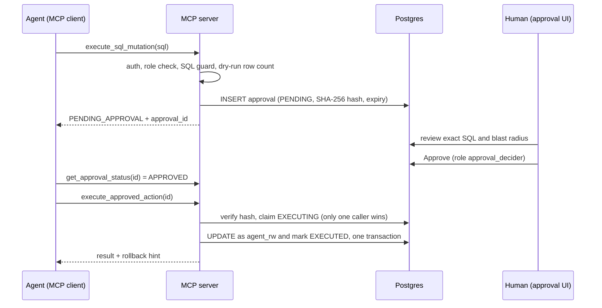

# Governed Ops MCP

Policy-gated MCP server with Postgres, Docker, and human approval for destructive actions.
An AI agent can triage an incident, but it cannot change production until a human approves the exact command.

## Quickstart
```
cp .env.example .env     # set all passwords (letters and digits only)
docker compose up -d --build
docker compose exec mcp-server python -m scripts.smoke_client   # 55 end-to-end checks
docker compose exec mcp-server python -m pytest -q              # unit and state-machine tests
docker compose exec mcp-server python -m scripts.verify_audit   # audit chain check
docker compose exec mcp-server python -m scripts.demo_outage    # the incident demo
```
- MCP endpoint: `http://localhost:8002/mcp` (header `Authorization: Bearer dev-operator-token`)
- Approval UI: `http://localhost:8003` (login `carol` / `dev-approver-pass`)
- Dev tokens and logins live in `docker-compose.yml`. Override with `MCP_API_TOKENS` and `APPROVERS` in `.env`.

## Tools
| Tool | Tier | Roles | Behavior |
|---|---|---|---|
| `search_logs`, `check_service_health`, `get_ticket`, `run_readonly_sql`, `get_approval_status` | 1 | viewer, operator | Run immediately |
| `add_ticket_comment`, `draft_postmortem` | 2 | operator | Run, audited |
| `execute_sql_mutation`, `restart_service` | 3 | operator | Create an approval request. Nothing runs. |
| `execute_approved_action` | 3 | operator, original requester only | Runs an approved request once |

## Tier 3 flow


## Request path
identity (bearer token) → role check → tier gate → audit `TOOL_CALL` → run → redact output → audit `TOOL_RESULT`.
No audit record means no action. Errors return a code, message, and hint, never a stack trace.

## Database roles
| Role | Can do |
|---|---|
| `ops_admin` | Owner. Migrations only. |
| `agent_ro` | SELECT on redacted views (`v_*`). Read-only, 5s timeout. |
| `agent_rw` | UPDATE orders/tickets, INSERT ticket_comments. Used only inside an approved execution. |
| `audit_writer` | INSERT and SELECT on `audit_events`. |
| `ops_executor` (MCP server) | Create approval requests, claim and finish executions. **Cannot approve.** |
| `approval_decider` (approval UI) | Approve or reject. **Cannot execute.** |

## Layers that stop a bad query
1. `sqlglot` guard: one SELECT over allowed views, or one `UPDATE ... WHERE` on `orders.status` / `tickets.status, severity`. The server runs the regenerated SQL, not the raw string.
2. Database roles with the minimum privileges, so raw tables and DDL fail even if the guard has a bug.
3. Read-only transactions, statement timeouts, and a 1000-row blast-radius cap.

## Approval safety
- **State machine in the database.** A trigger allows only legal moves and checks which role makes them. The MCP server cannot approve its own request.
- **Hash binding.** SHA-256 over tool, arguments, requester, and expiry. The approver sees the hash, and the executor recomputes it before running.
- **Idempotency.** A double click on Approve changes zero rows. `execute_approved_action` claims the request with one atomic UPDATE, so it runs once, and a repeat call returns the stored result.
- **Expiry.** Requests expire after 10 minutes, and the database refuses to approve or start an expired one.
- **Blast radius.** The approver sees the row count. At execution the server recounts and refuses if more rows match than were approved.
- **Rollback hints.** Each executed UPDATE stores the previous values and an undo statement.
- **Approver identity.** The requester cannot approve their own request (database CHECK and UI check).
- **UI hardening.** CSRF token, origin check, clickjacking protection, auto-escaped agent text.

## Audit log
Append-only table, triggers block UPDATE, DELETE and TRUNCATE, and each row stores `sha256(prev_hash + row)`.
`verify_audit` recomputes the chain and reports the first edited row.

## Progress

### Days 3-5: MCP server, governance layer, audit log
- **MCP server** (FastMCP, Docker, bearer-token auth) with four read tools and two audited write tools.
- **`@governed_tool` decorator.** Each call passes identity, role check, risk-tier gate, audit, redaction, audit. If the audit write fails, the action does not run.
- **SELECT-only SQL guard.** `sqlglot` parses the query, allows one SELECT over redacted views, and rejects `DROP`, stacked statements, `SELECT INTO`, `pg_sleep`, and catalog reads. The server runs the regenerated SQL, not the raw string.
- **Defense in depth.** Even if the guard failed, the `agent_ro` database role has SELECT on views only, runs read-only, and times out at 5 seconds.
- **Secret redaction** in database views, tool output, and saved comments.
- **Hash-chained audit log.** Append-only table, triggers block UPDATE, DELETE and TRUNCATE, and each row stores `sha256(prev_hash + row)`. Editing a row with the triggers disabled is caught and the first bad row is reported.
- **Structured errors** with a code, message, and retry hint. No stack traces reach the agent.
- **Tests:** 25 end-to-end checks through a real MCP client and 36 unit tests, including concurrent audit writers.

### Days 6-9: Human approval flow for risky actions
- **Approval state machine in Postgres.** A database trigger decides which role may make which state change (requested, approved, rejected, executed). The MCP server's role cannot approve, and the approval UI's role cannot execute. The rule is enforced by the database, not by application code.
- **Tier 3 tools create requests, they never run.** `execute_sql_mutation` and `restart_service` store an approval request and return. The request is bound to a SHA-256 hash of the exact command, plus a dry-run count of the rows it would change.
- **Approval UI** (`localhost:8003`). The reviewer sees the exact SQL, the blast radius (rows and table affected), the request hash, and the expiry time. It requires login, uses CSRF tokens, rejects cross-origin POSTs, and escapes any markup in the agent's text.
- **Safe execution.** `execute_approved_action` re-checks the hash, claims the request exactly once, and refuses to run if more rows now match than were approved. A repeated call returns the stored result instead of running again, and a different operator cannot execute someone else's approval.
- **Idempotency and rollback.** Each request carries an idempotency key. Executed actions return the rows affected and an undo hint.
- **Double-click and rejection handling.** A double click on Approve is safe, and a rejected request stays rejected.
- **Demo:** `python -m scripts.demo_outage` plays the incident. The agent triages the outage, requests the fix, waits for a human to approve in the UI, then executes. In the demo, 250 stuck orders were fixed after approval, and the audit chain stayed valid.
- **Tests:** 55 end-to-end checks through a real MCP client and 66 unit tests (4 skip inside the container because the approval role's password isn't passed to it).

Expiry handling, timeouts, and failure recovery come in Day 10.